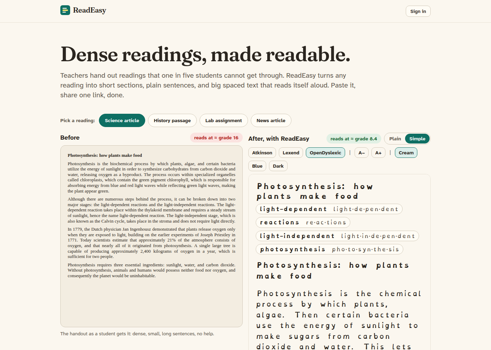
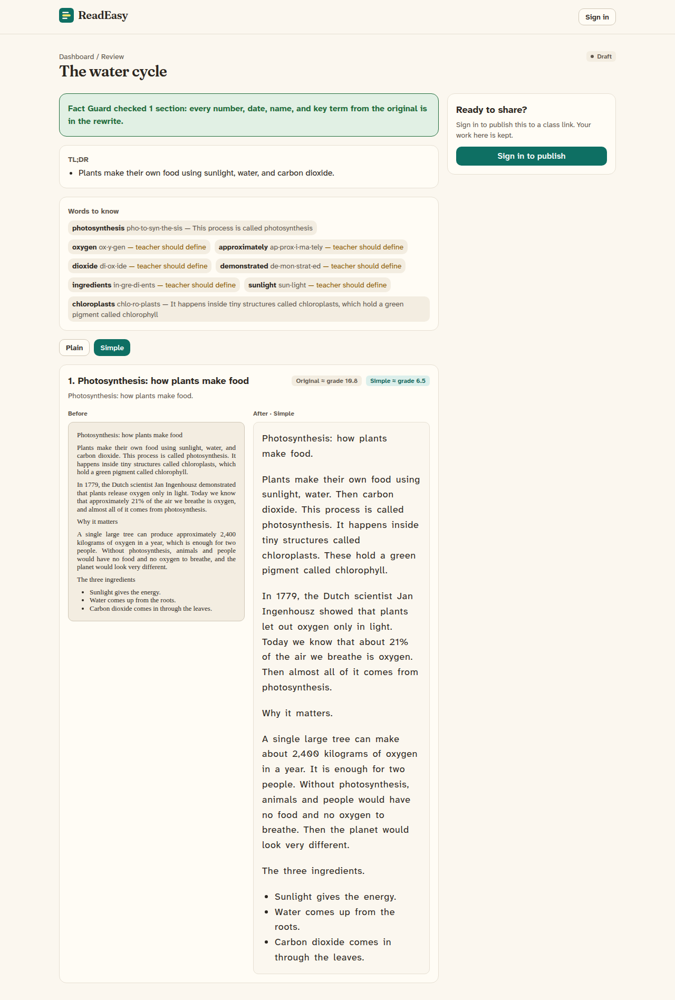
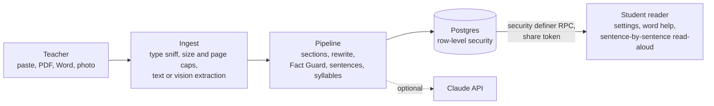

<div align="center">


# ReadEasy

**Paste or upload any reading and get one class link where it is split into short sections, rewritten in plain language, and read aloud with the current sentence lit.**

**[Try it → easy-read-lilac.vercel.app](https://easy-read-lilac.vercel.app)** (free, no sign-up for the demo)

</div>



## The problem

A teacher hands out a reading that part of the class cannot get through: long sentences, small type, words nobody defined. Rewriting it by hand takes longer than the five minutes between periods, and tools that rewrite it for you can quietly change the facts. Students who need help also tend to hide it, so a "dyslexia mode" they have to switch on is a mode they will not use.

**Goal: every student in the class reads the same material, comfortably, without the teacher doing extra work and without anyone being singled out.**

## How it works

1. **Bring a reading.** Paste text or upload a PDF, Word file, or photo of a handout. Four sample readings on the landing page work without signing in.
2. **Make it readable.** The reading is split into sections of roughly 100 to 200 words. Each gets a title, a Plain and a Simple version, and a grade estimate for each level.
3. **Check the facts.** **Fact Guard** compares every number, date, name, and key term in the original against the rewrite. If something is missing, it retries once. If it is still missing, the section keeps the original wording and the teacher sees exactly what was dropped.
4. **Publish.** The teacher gets one link per class and a QR code for the projector.
5. **Students read.** No account. They open the link, pick Original, Plain, or Simple, tap **Start reading**, and the sentence being read is highlighted. Tapping a word plays it and shows syllables and a definition.



## Product decisions

Each row is a numbered entry in [DECISIONS.md](DECISIONS.md), with the research behind it in [RESEARCH.md](RESEARCH.md).

| Decision | Trade-off |
| --- | --- |
| Fonts, spacing, and background tints are comfort settings, never sold as a treatment. Atkinson Hyperlegible is the default. | Gives up the easy marketing line ("a font for dyslexia"). The research it rests on found no gain from dyslexia-specific fonts and tinted overlays no better than placebo, so copy never claims one. |
| The same "Reading settings" for every student. No "dyslexia mode" and no labels. | Students cannot be auto-detected and helped. Students who hide an accommodation are not exposed by one. |
| Word help is on demand (tap), never silent replacement. Original is always one tap away. | Slower than auto-simplifying every hard word, but sentence-level rewrites can break meaning, so the student stays in control. |
| Fact Guard is the headline trust feature, and a failed check keeps the original text. | Some sections are not simplified at all. A wrong simplification is worse than a dense one. |
| Students never give the app anything: no accounts, no analytics, no tracking. Settings and progress live in the browser's local storage. | The teacher cannot see who read what. See [PRIVACY.md](PRIVACY.md). |
| Highlight the current sentence rather than flashing each word. | Less "karaoke", but calmer. Word underlines appear only when the browser reports word boundaries. |

## Architecture



One Next.js app on Vercel with Postgres behind it. Teacher data is isolated by row-level security. Students reach published content only through functions keyed by an unguessable 128-bit link token, and the tables are revoked from the anonymous role. The built-in rewriter is rule-based and runs in the browser for the landing demo. Claude is an optional provider behind the same interface.

## Hard problems

**Rewrites that quietly change the facts.** A model can fluently drop a date or a number. Fact Guard extracts entities from the source section, checks each is present in the rewrite, retries once with the missing list, and otherwise keeps the original text and flags the section. The checks and fixtures are in [src/lib/pipeline](src/lib/pipeline) and [src/lib/llm](src/lib/llm).

**A long document on a short-lived server.** Processing is a loop over sections rather than one long request. Each section row carries a status, a lease timestamp, and an attempt count. The client claims one pending section at a time, so a refresh, a closed tab, or a second tab just resumes, and one bad section never fails the whole material. Leases expire after 90 seconds.

**Read-aloud that works in every browser.** Browsers cut off long speech after about 15 seconds, and iOS only allows speech started inside a tap. The reader speaks one sentence per utterance, chained on the previous one ending, which also gives sentence highlighting everywhere. Speech starts synchronously in the tap handler for iOS. See [src/lib/tts](src/lib/tts).

**Row-level security you can actually test.** The same SQL migrations run against an in-process Postgres (PGlite) for tests and local dev and against hosted Postgres in production, so the tests exercise the real policies, with no Docker. The policy tests are in [tests/rls](tests/rls).

## Results

- **252 unit and policy tests pass** across 7 test files (`npm test`, run for this README). They cover section chunking, the LLM providers, text-to-speech, the environment checks, the row-level security policies, and a check that fails the build if a raw color appears outside the design tokens.
- **A browser smoke test walks the whole demo path in 18 steps** (paste, adapt, review, sign in, publish, class page, reader, settings, QR), recorded in [PLAN.md](PLAN.md).
- **Contrast is computed, not eyeballed.** Ink on the cream background is 14 to 1, and the teal brand color is 5.66 to 1, which clears AA for body text. The highlight yellow is paired with a darker bar so the current sentence still reads in grayscale ([DECISIONS.md](DECISIONS.md), entry 11).

**Not measured yet.** The hosted demo uses the built-in rule-based rewriter, not Claude (its `/api/health` reports `"llm":"mock"`), so rewrite quality with a real model is untested at scale. There are no cross-browser runs beyond Chromium, no load test, no Lighthouse run, and no study with real students or teachers. The grade levels shown are readability estimates, not assessments.

## How it was built

1. **Research and brand first.** Dyslexia and literacy evidence, competitors, and typography were written up before any code, then turned into a [brand system](BRAND.md) and a numbered decision log.
2. **Scaffold with the security model.** Design tokens, the database schema with row-level security, the data layer, and CI came before any screen.
3. **Pipeline and teacher flow.** Ingestion, the text pipeline, the LLM providers, and the end-to-end teacher and student flows, with a browser smoke test.
4. **Hardening.** A CSP nonce on every script, file upload, a health check, and a production secret check. A stray test that wrote outside the repo was removed.
5. **A rewriter that needs no key.** A rule-based plain-language adapter became the built-in rewriter, and the landing page became a live Before and After demo with real reading settings.
6. **Deploy and fix.** Three environment variables to deploy, simple sign-in, uploads stored in the database, and an accessibility audit script. Then fixes found in use: backgrounds and class themes that did not apply, and a review page that crashed on hosted Postgres.

## Tech stack

| Layer | Technology |
| --- | --- |
| Frontend | Next.js 16 (App Router), React 19, TypeScript, Tailwind CSS v4 |
| Rewriting | Built-in rule-based adapter; optional Claude via the Anthropic SDK |
| Text and files | `unpdf`, `mammoth`, `file-type`, `@mozilla/readability`, `sbd`, `hyphen`, `syllable` |
| Data | Postgres with row-level security (`postgres.js`; PGlite for tests and local dev) |
| Auth and storage | Simple email sign-in; optional Supabase Auth and Storage |
| Read-aloud | Web Speech API |
| Testing | Vitest, Playwright, axe |
| Hosting | Vercel |

## Run it locally

```bash
pnpm install
cp .env.example .env.local   # works as is: in-process database, no API key
pnpm dev                     # http://localhost:3000
pnpm check                   # lint, typecheck, and all tests
pnpm test:smoke              # browser walk through the demo path, after `pnpm build && pnpm start`
```

With no keys set, everything runs locally. To use a hosted database, set `DATABASE_URL` and run `pnpm db:migrate`. Details and every variable are in [.env.example](.env.example).

## Project structure

```
src/app/          Routes: landing, dashboard, materials, class page /c, reader /r, QR, API
src/components/   UI kit, teacher screens, student reader
src/lib/pipeline/ Chunking, Fact Guard, sentences, syllables
src/lib/llm/      Provider interface, mock and Anthropic providers
src/lib/ingest/   File and URL ingestion with size caps and an SSRF guard
src/lib/tts/      Sentence-chained read-aloud
src/lib/db/       SQL with row-level security applied per request
supabase/         Migrations
tests/            Unit and row-level security tests
```

## What's next

**Known limits.** URL import has an API route and a safety guard but no field in the interface yet. Quick-check questions are generated and validated but not shown to students. Email sign-in with a real provider needs a configured Supabase project. See the full list in [PLAN.md](PLAN.md).

**Next.** Run the rewriter with a real model and compare it against the built-in one on a set of real handouts, run the cross-browser and accessibility passes, and try it with a teacher.

[Brand](BRAND.md) · [Decisions](DECISIONS.md) · [Research](RESEARCH.md) · [Privacy](PRIVACY.md) · [Demo script](DEMO.md)
